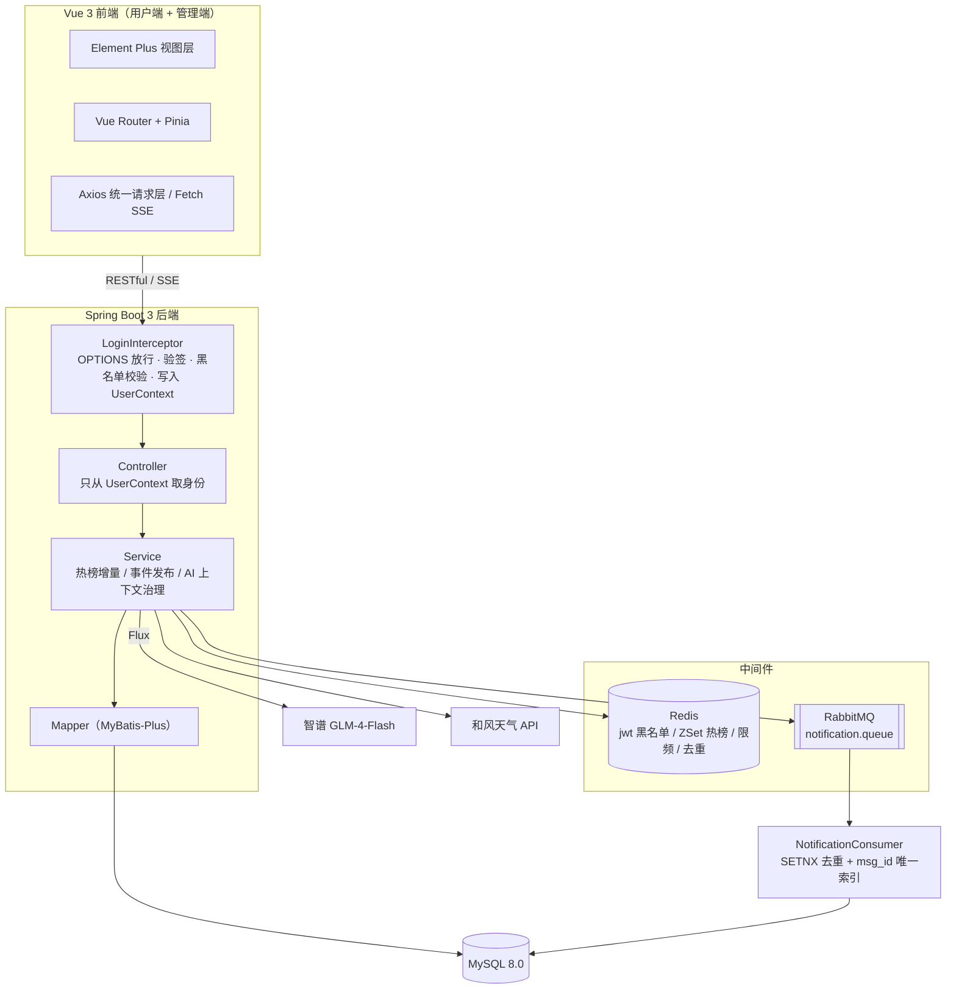
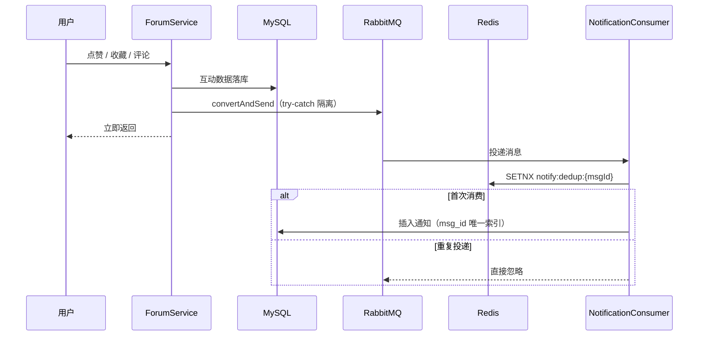

<div align="center">

# 极客技术社区 (Geek Tech Community)

**面向校招生与开发者的技术问答社区 · 前后端分离 · 拦截器统一鉴权 / Redis 实时热榜 / RabbitMQ 异步通知 / AI 助教**


</div>

> **开发说明**：后端（数据库建模、RESTful API 设计、拦截器鉴权体系、Redis 热榜引擎、RabbitMQ 异步通知、Spring AI 流式接入）为独立设计与实现；前端基于 Vue 3 + Element Plus，按功能域分层重构，UI 层借助 AI 辅助生成。

---

## 目录

- [功能特性](#功能特性)
- [界面预览](#界面预览)
- [技术栈](#技术栈)
- [系统架构](#系统架构)
- [核心技术实现](#核心技术实现)
- [项目结构](#项目结构)
- [快速开始](#快速开始)
- [路线图](#路线图)
- [开源协议](#开源协议)

---

## 功能特性

### 用户端

| 模块 | 核心能力 |
| :--- | :--- |
| **账号与安全** | 邮箱注册、JWT 无状态登录、`BCrypt.matches` 密码校验、Redis 验证码防刷、密码找回、登出即失效（`jti` 黑名单） |
| **个人中心** | 资料维护、头像上传、隐私开关（联系方式是否对外展示） |
| **内容发布** | Quill 富文本发帖（Delta JSON 存储）、图片按日期归档、编辑 / 删除、按板块检索、关键词搜索 |
| **社区互动** | 评论与楼中楼回复、点赞、收藏、收藏夹 |
| **实时热榜** | Redis ZSet + 时间衰减模型，兼顾新帖曝光与老帖下沉 |
| **站内通知** | RabbitMQ 异步投递，覆盖点赞 / 收藏 / 评论 / 回复四类事件，Redis 去重 + 唯一索引兜底 |
| **AI 极客助教** | 智谱 `GLM-4-Flash` + WebFlux `Flux` 流式对话，滑动窗口上下文裁剪、角色白名单过滤、按用户限频 |
| **环境卡片** | 和风天气 API（Ed25519 签名），实况与逐小时预报 |

### 管理端

| 模块 | 核心能力 |
| :--- | :--- |
| **内容治理** | 帖子置顶、锁定、隐藏、删除、版块迁移 |
| **版块管理** | 技术板块（软开 / 嵌入式 / 求助帖 / 求职面试 / 聊公司）的新增与改名 |
| **用户管理** | 用户检索、详情查看、封禁 / 解封、密码重置（基于 JWT `role` 的两级权限隔离） |
| **邮件审计** | 验证码邮件发送记录追踪与手动重发 |

---

## 界面预览

<div align="center">


<details>
<summary><b>点击展开更多截图（帖子详情 / 编辑器 / 个人中心 / 管理后台）</b></summary>
<br>


</details>

</div>

---

## 技术栈

**后端**

| 层次 | 选型与说明 |
| :--- | :--- |
| 语言与框架 | Java 17 · Spring Boot 3.5.8 · Spring Web · Jakarta Validation |
| 持久层 | MyBatis-Plus 3.5.15 · MySQL 8.0 |
| 缓存 | Redis 7（验证码 TTL · ZSet 热榜 · AI 限频计数 · MQ 消费去重） |
| 消息队列 | RabbitMQ 3.8（站内通知异步解耦） |
| AI 与三方集成 | Spring AI（OpenAI 兼容端点对接智谱 `GLM-4-Flash`、`Flux` 响应式流）· Spring Mail · 和风天气 |
| 安全与工具 | JJWT 0.12.6 · `BCryptPasswordEncoder` · Lombok 1.18.42 · Maven |

**前端**

| 层次 | 选型与说明 |
| :--- | :--- |
| 核心框架 | Vue 3 · Vue Router · Pinia · Vite |
| UI 与通信 | Element Plus · Axios（统一请求层）· Fetch SSE · VueQuill · `quill-delta-to-html` |

---

## 系统架构



> **鉴权架构**：身份解析已收敛到 `HandlerInterceptor`。拦截器负责「你是谁」——验签、查 `jti` 黑名单、把 `CurrentUser` 写进 `ThreadLocal`；Controller 只负责「你要干什么」，通过 `UserContext.getUid()` 直接取。授权（能不能操作这条帖子）仍留在 Service 层，因为它和具体资源绑定，属于业务规则。

---

## 核心技术实现

### 一、鉴权收口：拦截器 + ThreadLocal 上下文 + `jti` 黑名单

早期实现里每个 Controller 方法都要 `@RequestHeader("Authorization")` 拿 token，再调 `JwtUtils` 解析，29 处重复代码，且**任何一处漏写就等于这个接口没有鉴权**。

改造后：

```text
请求 → LoginInterceptor.preHandle
        ├─ OPTIONS 预检：直接放行
        ├─ 白名单路径（/api/auth/**、公开列表、/images/**）：跳过
        ├─ jwtUtils.parse(header) 验签 → 拿到 uid / role / jti
        ├─ 查 Redis jwt:blackList:{jti} → 命中则视为已登出
        └─ UserContext.set(new CurrentUser(uid, role)) → 放行
请求结束 → afterCompletion → UserContext.clear()
```

- **为什么用 ThreadLocal**：一次请求在 Tomcat 里由一个线程跑完，把用户挂在线程上，Service 层不用逐层传参；请求结束必须 `remove`，否则线程复用会串号。
- **登出即失效**：JWT 本身无状态、签出去撤不回，所以签发时写入 `jti`，登出时把 `jti` 写进 Redis，**TTL 按 `exp` 剩余时间算**，token 过期后黑名单自动清理。
- **白名单要短且准**：写 `/**` 就必须放过静态资源与预检请求，否则 `` 请求不带 `Authorization` 头会全站 401；写 `/api/**` 则可以让静态资源天然不受影响。
- **职责边界**：认证是横切的，适合拦截器；授权和资源绑定（这条帖子是不是你的），留在 Service，或用注解 + AOP 按接口标注。

### 二、实时热榜：时间衰减 + RENAME 原子切换 + 内存保序

按累计点赞排序会让老帖长期霸榜，新帖没有曝光机会。本项目用时间衰减计算热度：

```text
Score = (点赞 × 1 + 收藏 × 2 + 评论 × 3) / (发帖小时数 + 2)^1.8
```

- **权重按行为成本递增**：点赞成本最低（×1）、收藏代表长期参考价值（×2）、评论需要思考输入（×3）。
- **分母平滑**：`+2` 防止刚发布的帖子分母趋近 0 导致分数畸高；指数 `1.8` 控制衰减斜率，让新帖在 24 小时内有冲击榜单的能力。
- **增量 + 全量双通道**：互动发生时用 `ZINCRBY` 按权重修正单帖分数（点赞 ±1、收藏 ±2、评论 ±3）；`HotScoreInitializer` 每 10 分钟全量扫描**近 30 天**的帖子重算，启动时也会跑一次。
- **RENAME 原子切换**：全量重算先写临时 Key `hot_tem`，算完用一条 `RENAME` 覆盖线上 `forum:hot`，避免「先删后建」造成的瞬间空榜。
- **`IN` 查询 + 内存重排**：从 ZSet 取 Top-N 的帖子 ID 后批量回表，数据库按主键顺序返回会打乱榜单，所以在内存里按原 ID 顺序重排（`O(N)`）。

### 三、异步通知：主流程解耦 + SETNX 去重 + 唯一索引兜底



- **故障隔离**：发送端 `try-catch` 包住 `convertAndSend`，RabbitMQ 抖动时点赞、评论主流程照常返回，不被通知拖累。
- **两层幂等**：消息带确定性业务 ID（`like:{uid}:{tid}`、`comment:{id}`），先用 Redis `SETNX` 拦掉高频重复投递，再由通知表 `msg_id` 唯一索引做最终兜底。
- **补偿**：写库失败时删掉 SETNX 标记，避免重投时被误判为「已消费」而永久丢通知。

### 四、AI 助教：SSE 流式 + 窗口裁剪 + 防注入

- **流式响应**：`ChatClient.prompt().system(...).stream().content()` 返回 `Flux<String>`，以 `text/event-stream` 推送；前端用 `fetch` + `ReadableStream` 按 `\n\n` 切分事件（`EventSource` 不支持 POST，所以不能直接用）。
- **滑动窗口**：只保留最近 **5 轮（10 条）** 历史，并校验窗口头部不会残留 `assistant` 消息，控制 Token 成本。
- **防 Prompt Injection**：只放行 `user` / `assistant` 两种角色，前端伪造的 `system` 一律丢弃；系统提示词由后端强制注入。
- **限频**：单用户 60 秒内最多 5 次，Redis `INCR` + 首次写入绑定 TTL。

### 五、Quill Delta 解析与降级

帖子正文以 Delta JSON 存储，后端封装解析器用于列表摘要与通知预览：

- 遍历 `ops` 提取纯文本，图片节点替换为 `[图片]`，压平换行后截断。
- **差异化降级**：列表摘要解析失败返回原文（保证可读），通知预览解析失败返回空串（避免把 JSON 源码推给用户）。

### 六、接口语义：写操作一律不用 GET

`GET` 删除帖子、`GET` 点赞这类写法，会被浏览器预取、爬虫、`` 误触发，且不符合 HTTP 语义。全项目整改为：

| 行为 | 接口 |
| :--- | :--- |
| 删帖 / 删评论 | `DELETE /api/forum/topics/{tid}`、`/api/forum/comments/{id}` |
| 点赞 / 收藏 | `POST /api/forum/interactions`（body 显式传 `state`，避免「取反」语义导致重复请求翻转） |
| 通知已读 | `DELETE /api/notification/{id}`、`/api/notification/all` |
| 后台删帖 / 改分类 / 重发邮件 | `DELETE` / `PATCH` / `POST` |
| 登出 / 获取验证码 | `POST /api/auth/logout`、`POST /api/auth/code` |

---

## 项目结构

```text
forum/
├── backend/
│   ├── forum.sql                        建库脚本（含表结构与初始板块）
│   └── src/main/java/com/box/
│       ├── Interceptor/    LoginInterceptor：验签、黑名单、写 UserContext
│       ├── common/         Result 统一响应、UserContext(ThreadLocal)
│       ├── config/         WebMvc 注册拦截器 / Redis / RabbitMQ / MyBatis-Plus / 热榜重算任务
│       ├── constant/       Redis Key 前缀、MQ 常量
│       ├── consumer/       NotificationConsumer 异步消费
│       ├── controller/     RESTful 接口（用户端 / 管理端 / AI 流式端点）
│       ├── dto/            入参对象与校验规则
│       ├── entity/         数据库实体与 CurrentUser
│       ├── exception/      BusinessException + 全局异常处理
│       ├── mapper/         MyBatis-Plus Mapper
│       ├── service/Impl/   业务实现（热榜、AI 上下文、鉴权）
│       ├── utils/          JwtUtils / 和风天气 Ed25519 签名
│       └── vo/             视图对象
└── frontend/
    └── src/
        ├── api/            request.js 统一请求层 + 按模块拆分的接口
        ├── features/       topic / user / admin / auth / settings / home / ai / weather
        │   ├── pages/      路由页面
        │   └── components/ 业务组件
        ├── router/         路由与登录守卫
        ├── shared/         components（通用组件）、layouts（AppShell）
        ├── stores/         Pinia 状态
        └── assets/         tokens.css 设计变量、Quill 样式
```

---

## 快速开始

### 一、环境要求

| 组件 | 版本 |
| :--- | :--- |
| JDK | 17 或 21（用 JDK 23+ 编译需加 `-Dmaven.compiler.proc=full`） |
| Maven | 3.8+ |
| MySQL | 8.0+ |
| Redis | 7.0+ |
| RabbitMQ | 3.8+ |
| Node.js | 18+ |

### 二、初始化数据库

```sql
CREATE DATABASE forum DEFAULT CHARACTER SET utf8mb4 COLLATE utf8mb4_unicode_ci;
USE forum;
SOURCE backend/forum.sql;
```

### 三、配置（敏感信息不入库）

仓库里只有占位符，真实配置放在 `application-dev.yml`（已加入 `.gitignore`）：

```bash
cd backend/src/main/resources
cp application-dev.yml.example application-dev.yml
```

| 配置项 | 说明 |
| :--- | :--- |
| `spring.datasource.password` | MySQL 密码 |
| `spring.rabbitmq.host / username / password` | RabbitMQ 连接信息 |
| `spring.mail.username / password` | 发件邮箱与 SMTP 授权码 |
| `spring.ai.openai.api-key` | 智谱 `GLM-4-Flash` API Key |
| `jwt.secret` | HMAC-SHA 签名密钥，**长度 ≥ 32 字节** |
| `qweather.*` | 和风天气 Host / Kid / 私钥路径（可选） |

### 四、启动

```bash
# 后端（默认 8080）
cd backend
mvn clean install
mvn spring-boot:run

# 前端（默认 5173，/api 与 /images 已在 vite.config.js 代理到 8080）
cd frontend
npm install
npm run dev
```

浏览器打开 `http://localhost:5173`。

> 首次启动会自动重算一次热榜，之后每 10 分钟刷新；Redis 不可用时热榜为空，但不影响帖子列表。

---

## 路线图

- [x] 拦截器统一鉴权 + `jti` 黑名单登出
- [x] 写操作接口语义整改（GET → POST / PUT / DELETE / PATCH）
- [x] 前端按功能域分层 + 设计变量统一视觉
- [ ] 代码块语法高亮（`highlight.js` 渲染后处理）
- [ ] AI 代码辨析独立页（同一 SSE 接口，结构化输出）
- [ ] 采纳答案 + 声望体系（问答形态闭环）
- [ ] 面试复盘结构化字段（公司 / 轮次 / 结果 / 题目）

---

## 开源协议

本项目基于 [MIT License](LICENSE) 发布。
