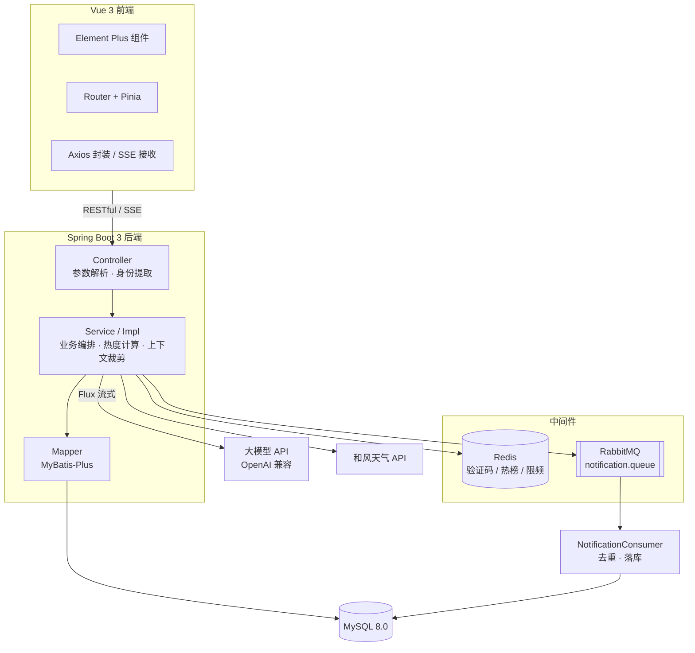
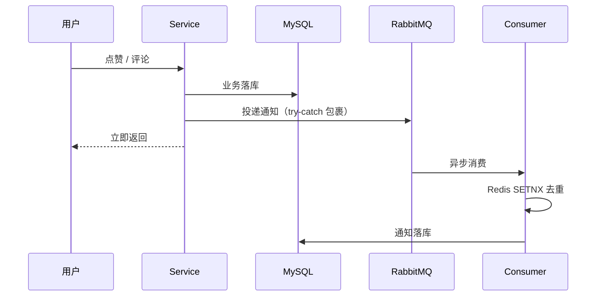

<div align="center">

# 校园论坛 Campus Forum

**面向高校场景的社区互动平台 · 前后端分离 · 实时热榜 / 异步通知 / AI 助手**


</div>

> **开发说明**：后端从数据库建模、接口设计到中间件集成为独立实现；前端基于开源工程二次开发并完成全链路联调。

---

## 目录

- [功能特性](#功能特性)
- [界面预览](#界面预览)
- [技术栈](#技术栈)
- [系统架构](#系统架构)
- [核心技术实现](#核心技术实现)
- [项目结构](#项目结构)
- [快速开始](#快速开始)
- [开源协议](#开源协议)

---

## 功能特性

### 用户端

| 模块 | 能力 |
| :--- | :--- |
| **账号与安全** | 注册、无状态登录（JWT）、BCrypt 密码存储、邮箱验证码、密码找回 |
| **个人中心** | 资料维护、头像上传、隐私权限设置 |
| **内容发布** | 富文本发帖（图片按日期归档）、编辑、删除、分类检索 |
| **互动** | 多级评论与回复、点赞、收藏 |
| **实时热榜** | Redis ZSet + 时间衰减模型，新帖有曝光、老帖会下沉 |
| **站内通知** | RabbitMQ 异步投递，点赞 / 收藏 / 评论 / 回复四类消息 |
| **AI 助手** | SSE 流式对话，逐字返回 |
| **天气卡片** | 和风天气实况 + 逐小时预报 |

### 管理端

| 模块 | 能力 |
| :--- | :--- |
| **内容治理** | 置顶、加精、锁定、屏蔽、删除、版块迁移 |
| **版块管理** | 分类的增删改查 |
| **用户管理** | 用户检视、状态管控、密码重置 |
| **邮件记录** | 发送记录追踪与异常邮件重发 |

---

## 界面预览

<div align="center">


<details>
<summary><b>点击展开更多截图（帖子详情 / 编辑器 / 个人中心 / 管理后台）</b></summary>
<br>


</details>

</div>

---

## 技术栈

**后端**

| 层次 | 选型 |
| :--- | :--- |
| 语言与框架 | Java 17 · Spring Boot 3.5.8 · Spring Web · Validation |
| 持久层 | MyBatis-Plus 3.5.15 · MySQL 8.0 |
| 缓存 | Redis 7（验证码 TTL · ZSet 热榜） |
| 消息队列 | RabbitMQ 3.8（异步通知） |
| AI 与三方 | Spring AI（Reactor 流式）· Spring Mail · 和风天气 API |
| 安全与工具 | JJWT · BCrypt · FastJSON2 · Lombok · Maven |

**前端**

| 层次 | 选型 |
| :--- | :--- |
| 框架 | Vue 3 · Vue Router · Pinia · Vite |
| UI 与工具 | Element Plus · Axios · VueQuill |

---

## 系统架构



> 鉴权采用「Controller 方法显式取 `Authorization` 头 → `JwtUtils` 解析」的方式，未收敛到拦截器；集中式拦截器属于后续优化项。

---

## 核心技术实现

### 一、热榜：时间衰减 + 原子切换

传统「按累计点赞排序」会让老帖长期霸榜，新帖没有曝光机会。这里用互动量除以时间衰减因子：

```
Score = (点赞 × 1 + 评论 × 3 + 收藏 × 2) / (发帖小时数 + 2)^1.8
```

- **权重按用户成本递增**：点赞最轻（1）、收藏代表「以后有用」（2）、评论要打字（3）
- **指数 1.8**：1 衰减太慢、2 又太陡，1.8 是围绕「新帖能压过一天前的帖」这个目标调出来的
- **增量 + 全量双通道**：互动时实时 `incrementScore`，定时任务全量重算修正漂移
- **无窗口切换**：重算先写临时 Key，算完 `RENAME` 覆盖线上 Key。`RENAME` 是单条原子命令，中途不存在「两边都没数据」的空档，读者不会看到空榜

### 二、通知：异步解耦 + 消费幂等



三个关键设计：

- **主链路不被拖累**：`convertAndSend` 包了 try-catch，MQ 不可用时点赞/评论照样成功
- **消费端幂等**：消息带业务事件 ID（`comment:123` / `like:4:32`），`SETNX` 挡一层，`msg_id` 唯一索引兜底
- **失败撤销标记**：入库失败要删掉去重标记，否则重投会被误判成重复，通知永久丢失

### 三、AI 助手：流式 + 限频 + 上下文治理

- **SSE 逐字推送**：`ChatClient.prompt().stream().content()` 返回 `Flux<String>`，首字节即可响应。实测首字节 1.84s、完整回答 2.96s，差值就是流式省下的等待
- **滑动窗口裁剪**：只保留最近 5 轮（10 条消息），并去掉开头可能出现的 assistant 消息 —— 对话以模型发言开头会让模型困惑
- **角色过滤**：只接受 `user` / `assistant`，前端传 `system` 一律丢弃；系统提示词由服务端固定，防提示词注入
- **限频**：60 秒窗口 5 次，`increment` 首次建键时设 TTL，之后不重置窗口

### 四、认证与安全

- **无状态认证**：JWT 携带 uid / role，密钥从配置读取并在 `@PostConstruct` 阶段构造 —— 配错会在启动时直接失败，而不是等到第一个请求进来才 500
- **密码存储**：BCrypt 自适应哈希；注册加密、登录 `matches` 校验、改密校验原密码、后台重置，四条链路统一
- **验证码防重放**：Redis 存码并设严格 TTL，校验通过立即销毁；连续错 5 次锁定并要求重发
- **账号枚举防护**：登录失败统一提示「账号或密码错误」，不区分「用户不存在」与「密码错误」

### 五、富文本处理

Quill 输出的是 Delta JSON（`{"ops":[{"insert":"..."}]}`），不能直接当文本用：

- **摘要提取**：遍历 `ops` 取文本节点，图片替换为 `[图片]`，压平换行后截断
- **两种降级策略**：帖子摘要失败返回原文（保住展示），通知摘要失败返回空（空白比乱码好）
- **长度由调用方决定**：列表摘要 8 字、引用评论 20 字，底层方法只负责抽文本

---

## 项目结构

```text
forum/
├── backend/
│   ├── src/main/java/com/box/
│   │   ├── common/      统一返回结果封装
│   │   ├── config/      Redis / RabbitMQ / MyBatis-Plus / 密码编码器
│   │   ├── constant/    Redis Key 常量
│   │   ├── consumer/    RabbitMQ 消费者
│   │   ├── controller/  RESTful 接口
│   │   ├── dto/         请求对象
│   │   ├── entity/      数据库实体
│   │   ├── exception/   业务异常与全局处理
│   │   ├── mapper/      MyBatis-Plus 数据访问
│   │   ├── service/     业务接口
│   │   │   └── Impl/    业务实现
│   │   ├── utils/       JwtUtils / 天气 JWT 等工具
│   │   └── vo/          视图对象
│   └── src/main/resources/
│       ├── application.yml
│       └── mapper/      自定义 SQL
└── frontend/
    └── src/
        ├── components/  公共组件
        ├── net/         Axios 封装与接口定义
        ├── router/      路由
        ├── store/       Pinia
        └── views/       页面（用户端 / 管理端）
```

---

## 快速开始

### 一、环境要求

| 组件 | 版本 |
| :--- | :--- |
| JDK | 17+ |
| Maven | 3.8+ |
| MySQL | 8.0+ |
| Redis | 6.0+ |
| RabbitMQ | 3.8+ |
| Node.js | 18+ |

### 二、初始化数据库

```sql
CREATE DATABASE forum DEFAULT CHARACTER SET utf8mb4;
USE forum;
SOURCE forum.sql;
```

### 三、配置

所有敏感配置都从 `application.yml` 里抽出来了，仓库中只保留占位符，**默认值不含任何密钥**。

```bash
cd backend/src/main/resources
cp application-dev.yml.example application-dev.yml
```

然后在 `application-dev.yml` 里填写真实值（这个文件已被 `.gitignore` 忽略，不会提交）：

| 配置项 | 说明 |
| :--- | :--- |
| `spring.datasource.password` | MySQL 密码 |
| `spring.rabbitmq.host / username / password` | RabbitMQ 地址与账号 |
| `spring.mail.username / password` | QQ 邮箱与 SMTP 授权码 |
| `spring.ai.openai.api-key` | 大模型 API Key（不用 AI 可留空） |
| `qweather.*` | 和风天气 host / kid / sub / iss / 私钥路径（不用天气可留空） |
| `jwt.secret` | JWT 签名密钥，**至少 32 字节** |

也可以不建这个文件，直接用环境变量覆盖：

```bash
DB_PASSWORD=xxx RABBITMQ_PASSWORD=xxx ZHIPU_API_KEY=xxx JWT_SECRET=xxx mvn spring-boot:run
```

可选环境变量全表：`DB_USERNAME` `DB_PASSWORD` `RABBITMQ_HOST` `RABBITMQ_PORT` `RABBITMQ_USERNAME` `RABBITMQ_PASSWORD` `ZHIPU_API_KEY` `MAIL_USERNAME` `MAIL_PASSWORD` `JWT_SECRET` `UPLOAD_DIR` `QWEATHER_*`

> ⚠️ `*.pem` 私钥、`application-dev.yml`、`.env` 都已在 `.gitignore` 中，**不要用 `git add -f` 强行提交**。


### 四、启动

```bash
# 后端，默认 8080
cd backend
mvn clean install
mvn spring-boot:run
```

```bash
# 前端，默认 5173
cd frontend
npm install
npm run dev
```

浏览器打开 `http://localhost:5173`。

---

## 开源协议

本项目基于 [MIT License](LICENSE) 发布。
